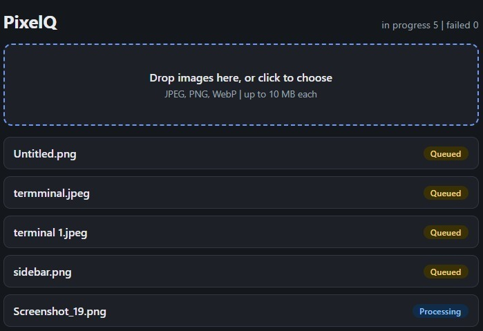
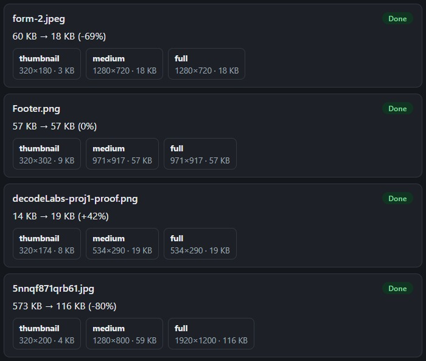
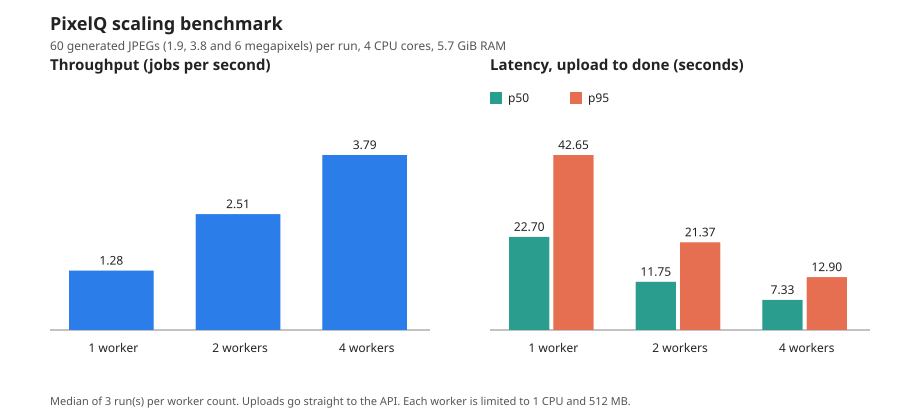
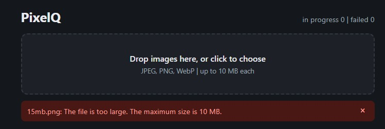
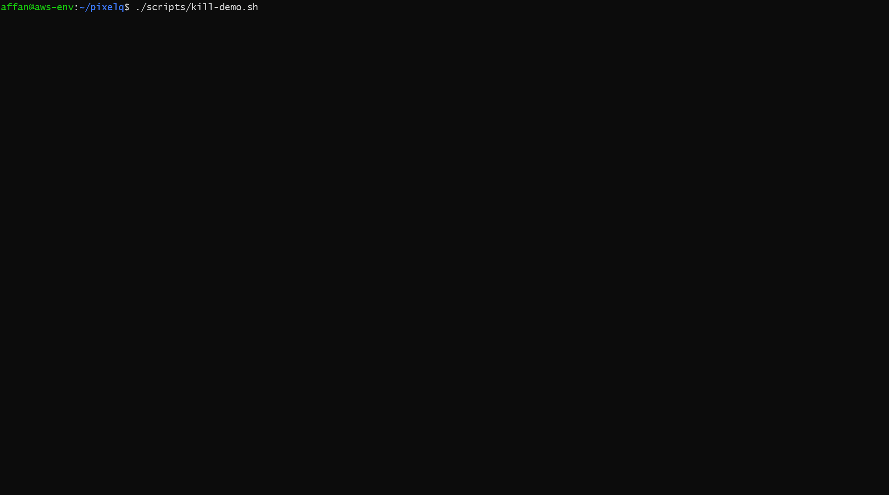

# PixelQ

[](https://github.com/bugfinn/pixelq/actions/workflows/ci.yml)
[](LICENSE)

**A self-hosted image optimization service, built to be run safely and to be measured.**

Upload a JPEG, PNG or WebP file and PixelQ turns it into three WebP sizes (thumbnail, medium and full). A small web page and an HTTP API take the uploads, a queue (BullMQ on Redis) hands the work to background workers that use sharp, and Postgres keeps track of every job. The whole system is five containers in Docker Compose.

The image processing is the simple part. The point of the project is everything around it: how to run the containers with as few rights as possible, what happens when a worker is killed in the middle of a job, how much faster it gets with more workers, and how to prove each of those claims instead of just stating them.



## Quickstart

**You need:** Docker with Compose v2 (Docker Desktop, or Docker Engine with the compose plugin), about 2 GB of free memory, and port 8080 free on your machine. It was tested with Docker 29.8 and Compose 5.5 on Ubuntu 24.04 (WSL2).

```bash
git clone https://github.com/bugfinn/pixelq.git
cd pixelq
docker compose up -d --wait
```

The first start builds three images, which takes a few minutes (about 15 on a slow connection). The command finishes when all five services are healthy. Then open **http://127.0.0.1:8080** and drop in an image.

No configuration file is needed. The page is only reachable from your own machine (`127.0.0.1`).

**Use the API from a terminal:**

```bash
# upload an image (answers 202 with a job id)
ID=$(curl -s -F 'file=@photo.jpg' http://127.0.0.1:8080/api/jobs | grep -o '"id":"[^"]*"' | cut -d'"' -f4)

# check the job (status: queued, processing, done or failed)
curl -s http://127.0.0.1:8080/api/jobs/$ID

# download one size: thumbnail, medium or full
curl -s -o thumbnail.webp http://127.0.0.1:8080/api/files/$ID/thumbnail
```

**Run more workers:**

```bash
docker compose up -d --scale worker=4 --wait
```

**Stop it:**

```bash
docker compose down        # stops everything and keeps the data
docker compose down -v     # also deletes the database, queue and uploaded files
```

**If it does not start:** an error like `Bind for 127.0.0.1:8080 failed` means another program uses port 8080. Stop that program, or change the published port in `docker-compose.yml`.

## How it works



1. The **gateway** (Nginx) serves the page and forwards `/api` to the api. It limits the upload size and the upload rate.
2. The **api** (Fastify) checks the file, saves it under a random name, writes a `queued` job to Postgres and adds the job to the queue. It answers right away with a job id.
3. A **worker** takes the job from Redis, checks the image, writes the three WebP variants and marks the job `done`. If something goes wrong the job is retried, or marked `failed` with a clear reason.
4. The page asks for the job status every 2 seconds and shows the result, including how much smaller the file got.



Each card shows the size before and after, and the three variants with their dimensions. The output is not always smaller: in this example one small PNG came out 42% larger, and for images narrower than 1280 pixels the medium and full variants are the same size, because images are never enlarged.

Only the workers scale, because image processing is the slow part. Details, diagrams of the upload flow and the job states, and the failure handling are in [docs/architecture.md](docs/architecture.md).

## What was measured

All numbers come from one older desktop PC (Intel Core i5-4570, 4 cores, 5.7 GiB RAM visible to WSL) and are one-off measurements, not promises. The method, the commands and more caveats are in [docs/measurements.md](docs/measurements.md).

### Image sizes

| Image | Size (Node 26.13) | Before the Node 26 move (Node 24.21) |
| --- | --- | --- |
| pixelq-api | 407 MB | 383 MB |
| pixelq-worker | 400 MB | 377 MB |
| pixelq-gateway | 93.7 MB | 90.5 MB |

Local, uncompressed sizes. The same worker built on plain `node:24.21` instead of the slim image was 1.69 GB, about 4.5 times larger (measured once, on Node 24).

### Scaling with more workers



| Workers | Jobs per second | Speed-up | Time to finish 60 images at once (p50) | Time for one image (p50) | Worker memory peak |
| --- | --- | --- | --- | --- | --- |
| 1 | 1.28 | 1.00 | 22.7 s | 0.78 s | 207 MiB |
| 2 | 2.51 | 1.95 | 11.8 s | 0.79 s | 252 MiB |
| 4 | 3.79 | 2.95 | 7.3 s | 0.92 s | 276 MiB |

Medians of 3 runs of 60 generated JPEGs (1.9, 3.8 and 6 megapixels), no failed jobs. **Read this with care:**

- Measured on Node 24.21. A small trial on Node 26.13 (one worker, 12 images) gave the same 1.28 jobs per second, but the full benchmark was not repeated.
- One machine with 4 cores, and the load generator runs on the same CPUs.
- The images are generated noise, probably harder than real photos.
- "Time to finish 60 images" includes waiting in the queue. One image takes about 0.8 seconds.
- At 4 workers each worker used about 72% of its CPU, and I did not find out why.

Run it yourself: `node scripts/benchmark.ts` (see the top of the file for the options).

### Large images and the rate limit

| Test | Result |
| --- | --- |
| 45 megapixel JPEG (5.0 MB) | Done in 1.1 s. Worker memory peak 89 MiB of 512. |
| 49 megapixel PNG with alpha (the worst case I measured) | Done in 5.1 s. Worker memory peak 181 MiB of 512. |
| 55.7 megapixel JPEG (over the 50 megapixel limit) | Refused in 8 ms with "too many pixels", not retried. |
| 15 fast uploads through the gateway | The first 11 were accepted, from the 12th on the answer was `429`. Reads are never limited. |

Not tested: 16-bit and interlaced PNG files, which may need more memory.



The page refuses files over 10 MB, or of the wrong type, before uploading them, and the api checks again.

### What happens when a worker is killed



`scripts/kill-demo.sh` starts two workers, kills the one that is processing a job, and waits for the job to finish by itself. BullMQ notices that the job's lock expired and gives the job to the other worker. With BullMQ's default timings this takes about 60 seconds. With the shorter demo timings it took 8 seconds in one run on Node 24 and 19 seconds in one run on Node 26 (I did not look into the difference). The job ends with `attempts` of 2 and all three variants.

### Hardening check

`scripts/verify-hardening.sh` proves the container settings on a running stack instead of trusting the compose file. Each "blocked" check first runs a control, so a broken test cannot pass by accident. I also pointed it at weak containers on purpose, and it failed for the right reasons.

```text
Worker container: pixelq-worker-1
1/5 Read-only root filesystem
  [PASS] write to / refused (touch: cannot touch '/pixelq-write-test': Read-only file system); /tmp is writable as intended
2/5 No capabilities, no new privileges
  [PASS] CapEff=0000000000000000 CapBnd=0000000000000000 NoNewPrivs=1
3/5 No outbound internet
  [PASS] public site unreachable (blocked: EAI_AGAIN); the api is reachable on the internal network
4/5 Memory and CPU limits
  [PASS] memory 512 MB, swap limit 512 MB (equal), CPU limit 1.00
5/5 Non-root user
  [PASS] uid=1000(node) gid=1000(node) groups=1000(node)

API container: pixelq-api-1
1/2 No outbound internet
  [PASS] public site unreachable (blocked: EAI_AGAIN); postgres is reachable on the internal network
2/2 Attached to internal networks only
  [PASS] networks: pixelq_backend pixelq_frontend (all internal)

HARDENING CHECKS PASSED
```

## Security in short

PixelQ is meant for one machine. The gateway is published on `127.0.0.1` only, and there are no user accounts.

- **What can be uploaded.** The api reads the first bytes of the file and accepts only JPEG, PNG and WebP, whatever the file name or content type says. Files over 10 MB are refused (Nginx stops anything over 11 MB). The worker refuses images over 50 megapixels before it decodes them, and animated images.
- **What the containers can reach.** The api, worker, Redis and Postgres sit on internal networks with no route to the internet. Only the gateway has a published port.
- **What if the image library has a bug?** That cannot be fully prevented. The worker, which opens untrusted files, runs as a non-root user with a read-only filesystem, no Linux capabilities, no internet, and memory and CPU limits.
- **Supply chain.** Slim base images, a lockfile, Trivy scans that fail the build on fixable HIGH or CRITICAL findings, no stored cloud keys (GitHub OIDC), and a protected `main` branch.

The full list of attacks, what stops each one, how each was checked, and what is **not** covered is in [docs/threat-model.md](docs/threat-model.md).

## Design decisions

Each choice, and why it was made.

- **Multi-stage builds.** The build stage has pnpm and the dev tools. The final image has only the production dependencies and the compiled code, so it is smaller and has fewer things to attack. The gateway is built the same way: Node builds the page, and the final image is Nginx with the files.
- **Internal networks.** A bug in the api or worker should not be able to call out. Only the gateway sits on a network with a route out, because Docker cannot publish a port otherwise. This is checked by a script, not assumed.
- **Non-root, read-only, no capabilities, resource limits.** If a process is taken over, it can do as little as possible. Memory and CPU limits stop one bad job from starving the machine.
- **BullMQ.** A queue with retries, backoff, stalled-job recovery and repeating jobs, so none of that had to be written by hand. The kill demo shows the stalled-job recovery working.
- **Database first, with a fixed job id.** The api writes the job to Postgres as `queued` before it adds it to the queue, and the queue job id is the same UUID. If the api dies between the two steps, a repeating reconcile job adds the missing job again, and adding twice is harmless. A full transactional outbox would be more than v1 needs.
- **Cleanup uses `expires_at`.** Every finished job stores its own expiry time (24 hours after it finished). Cleanup is one query, and it does not depend on file timestamps. Files are deleted first, then the row.
- **Only the workers scale.** Image processing is the slow part, so that is what the benchmark scales. One api instance keeps the design simple.
- **Migrations run when the api starts.** No separate migration job. This is only safe with exactly one api instance, which is the v1 design. More instances would need a lock or a migration job.
- **Trivy runs from a pinned container image.** The official GitHub Action was compromised in March 2026 (its tags were rewritten), so the scanner is run from an image with a fixed version.
- **GitHub OIDC for ECR Public.** No long-lived AWS keys are stored in GitHub. The push role trusts only the `main` branch of this repository, and images are tagged with the commit SHA.
- **TypeScript is pinned to 6.0 for the api and worker.** typescript-eslint does not work with TypeScript 7 yet. This will be revisited with TypeScript 7.1.
- **Node 26 LTS on Debian 13 slim.** Node 26 became LTS on 28 October 2026. It no longer ships Corepack, so the Dockerfiles and CI install a pinned Corepack version.

## Known limitations

These are honest gaps, not hidden ones. The longer list, with reasons, is in the [threat model](docs/threat-model.md).

- No login and no TLS. It is not meant to be put on the public internet as it is.
- The default database password is `pixelq_dev`. Set `POSTGRES_PASSWORD` for anything beyond a local demo.
- The `uploads` volume has no size limit. A client could in theory write a lot of data in 24 hours, so keep the gateway on `127.0.0.1`.
- Over-limit and animated images are accepted at upload and refused by the worker, so their files stay until cleanup.
- The rate limit is per client address as Nginx sees it, and on this setup all local requests look like one address.
- The gateway can open outbound connections, because it needs one ordinary network for its published port.
- The hardening script checks the worker and the api, not the gateway, Redis or Postgres.
- Base images are pinned to a version tag, not to a digest, and some Dockerfile lines (the `perl-base`, `apt` and gateway package upgrades, and removing npm) are temporary fixes for scanner findings. New findings appear from time to time, and the CI scan will stop the build when one does.
- 16-bit and interlaced PNG files were not tested for memory use.
- The output can be larger than the input for small files that are already well compressed (a 14 KB PNG became 19 KB in the screenshot above). There is no rule that keeps the original when it is smaller.
- All measurements are from one machine, and the benchmark was not repeated on Node 26.
- Out of scope for v1: accounts, S3 storage, animated images, more than one api instance, and any cloud deployment.

## Project layout and scripts

```text
api/        Fastify api, database migrations, tests
worker/     BullMQ worker, sharp image code, tests
frontend/   React page (Vite)
gateway/    Nginx config and the gateway Dockerfile
packages/   Shared types
scripts/    smoke test, hardening check, image scan, benchmark, kill demo
infra/aws/  IAM policies for the ECR Public push (documented)
docs/       architecture, threat model, measurements, benchmark chart, kill demo
```

| Script | What it does |
| --- | --- |
| `./scripts/smoke-test.sh` | Uploads an image, waits, downloads the three variants, and checks that a text file is refused |
| `./scripts/verify-hardening.sh` | Proves the worker and api container settings (needs the base stack running) |
| `./scripts/scan-images.sh` | Scans the three images with Trivy (the first run downloads a database) |
| `node scripts/benchmark.ts` | Scaling benchmark with 1, 2 and 4 workers |
| `./scripts/kill-demo.sh` | Kills a worker in the middle of a job |

### Development

You need Node 26 (see `.nvmrc`) and pnpm. Node 26 does not include Corepack, so install it first:

```bash
npm install -g corepack && corepack enable
pnpm install --frozen-lockfile
pnpm -r run lint && pnpm -r run typecheck && pnpm -r run test && pnpm -r run build
```

The tests are 43 for the api, 65 for the worker and 13 for the page. `.env.example` holds the settings for running the api and worker directly on your machine (the Postgres and Redis addresses and the upload folders), plus an optional line that loads `docker-compose.dev.yml`. That file publishes Postgres, Redis and the api on `127.0.0.1` for development. Do not use it on a shared machine, and note that the example database password (`pixelq_dev`) is for local use only.

### CI and published images

Every pull request must pass the `ci` check before it can be merged into `main`. The job lints, type-checks, tests and builds, then builds the three images with layer caching, scans them with Trivy, runs the smoke test and the hardening check, and, on `main` only, pushes the images to ECR Public. They are public and tagged with the full commit SHA (there is no `latest`):

```text
public.ecr.aws/p9w4e3a1/pixelq-api
public.ecr.aws/p9w4e3a1/pixelq-worker
public.ecr.aws/p9w4e3a1/pixelq-gateway
```

The compose file builds the images locally, so you do not need them for the quickstart.

## License

[MIT](LICENSE)
