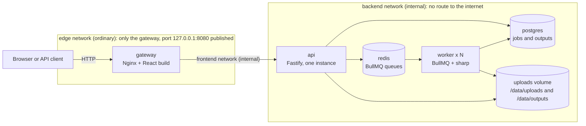
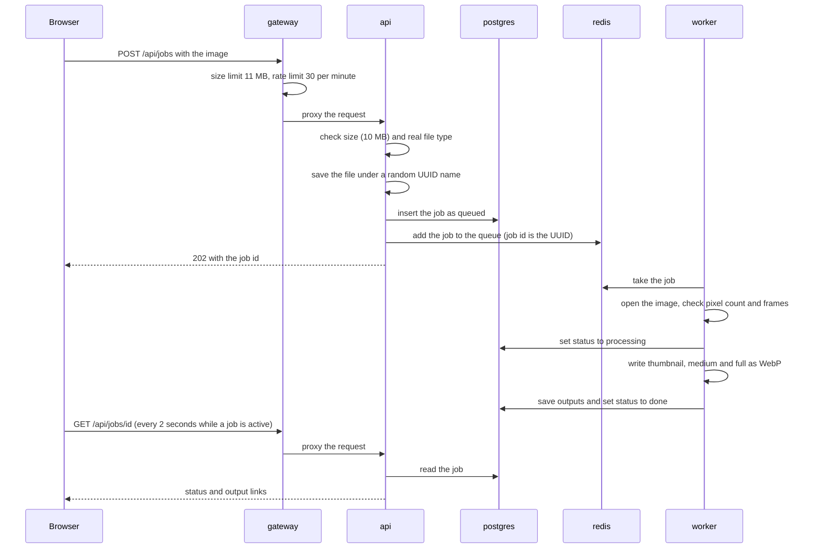
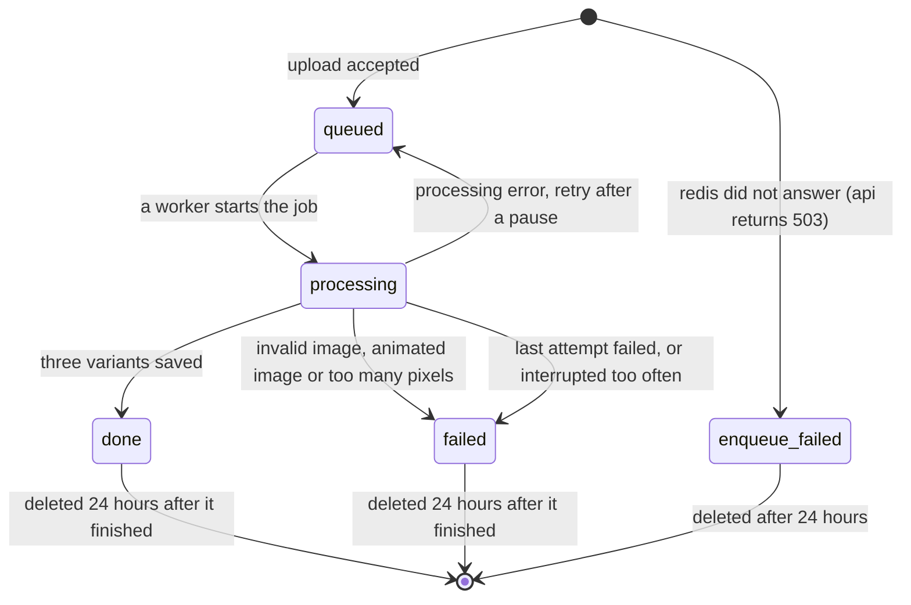

# Architecture

PixelQ is a self-hosted image optimization service. A user uploads a JPEG, PNG or WebP file, and background workers turn it into three WebP sizes (thumbnail, medium, full). The whole stack runs as five containers in Docker Compose.

This page shows how the pieces fit together. The security side is in [threat-model.md](threat-model.md), and the evidence for the numbers is in [measurements.md](measurements.md).

Last checked: 4 November 2026, on Node 26.13.

## Overview

The api sits on two internal networks, `frontend` (shared with the gateway) and `backend`. The diagram shows `frontend` as the label on the arrow between the gateway and the api.

## The five containers

| Container | What it does | Scales in v1 |
| --- | --- | --- |
| gateway | Serves the built React page, proxies `/api` to the api, limits the upload size (11 MB) and rate-limits uploads (30 per minute per client address, burst 10). Runs as the non-root user `nginx` (uid 101) on port 8080. | No |
| api | Checks uploads (size and real file type), saves the file, creates the job, adds it to the queue, runs the database migrations at startup, and serves the status, list, download, stats and health endpoints. It also listens to queue events so a job that failed for good is never stuck in `processing`. | No |
| worker | Takes jobs from the queue, resizes and converts images with sharp, and updates the database. It also runs the maintenance jobs (cleanup, orphan sweep, reconcile). Each worker handles one job at a time (`concurrency: 1`). | Yes, this is the part to scale |
| redis | The queue broker for BullMQ. | No |
| postgres | Stores the `jobs` and `outputs` tables. | No |

Only the worker scales (`docker compose up -d --scale worker=4`). That keeps the benchmark focused on the real bottleneck, which is image processing. The "migrations run at api startup" design assumes exactly one api instance.

There is no separate scheduler container. Cleanup and reconcile are repeating BullMQ jobs on a `maintenance` queue, and Redis keeps the schedule. Four workers do not run the schedule four times.

Base images: `node:26.13-slim` (Debian 13) for the api and worker, `nginxinc/nginx-unprivileged:1.30-alpine` for the gateway, `postgres:18.6-alpine` and `redis:8.6-alpine`. The React page is built in a separate Node stage, so the final gateway image holds only Nginx, the built files and the config (no Node, no source code).

## Networks

| Network | Type | Members | Why it exists |
| --- | --- | --- | --- |
| `edge` | ordinary | gateway | The only network with a route out. Docker cannot publish a port from a container that is only on internal networks, so the gateway needs one ordinary network. |
| `frontend` | internal | gateway, api | Carries the gateway to api traffic. Internal, so the api cannot reach the internet. |
| `backend` | internal | api, worker, redis, postgres | Queue, database and file work. Internal, so none of these can reach the internet, and nothing on it is published to the host. |

Two things follow from this:

- The gateway is the only service that publishes a port, and it publishes it on `127.0.0.1:8080`, so it is not reachable from other machines on the network.
- The gateway itself can still make outbound connections through `edge`. It is a static Nginx configuration with no outbound features, and this is listed in the [threat model](threat-model.md) as a known limit.

### Optional Compose files

These files add to the base `docker-compose.yml`. None of them is used by CI or the smoke test.

| File | What it adds | When to use it |
| --- | --- | --- |
| `docker-compose.dev.yml` | A fourth network, `dev` (ordinary), and publishes Postgres (5432), Redis (6379) and the api (3000) on `127.0.0.1`. | Development on the host. It is loaded only when `COMPOSE_FILE` is set in `.env`. That line is commented out in `.env.example`. |
| `docker-compose.bench.yml` | A network `bench` (ordinary) and publishes the api on `127.0.0.1:3000`. | The benchmark uploads straight to the api, so the gateway's rate limit is not measured. |
| `docker-compose.demo.yml` | Shorter lock and stalled-check timings for the worker, plus a 20 s delay on a job's first start. | The kill demo (`scripts/kill-demo.sh`). |

The dev and bench files give the api an ordinary network on purpose, so `scripts/verify-hardening.sh` is meant to run against the base file only.

## Volumes

| Volume | Mounted at | Holds |
| --- | --- | --- |
| `pgdata` | `/var/lib/postgresql` in postgres | The database |
| `redisdata` | `/data` in redis | Queue data, so it survives a restart |
| `uploads` | `/data` in **both** api and worker | `/data/uploads` (originals) and `/data/outputs` (WebP variants) |

The `uploads` volume is mounted at the same path in the api and the worker because the database stores absolute file paths.

`docker compose down` keeps all three volumes. `docker compose down -v` deletes them, including the database.

## Hardening and resource limits

Every service runs with a read-only root filesystem, no Linux capabilities, `no-new-privileges`, and limits on memory and CPU. The memory limit is real because swap is set equal to it.

| Service | Memory (and swap) | CPUs | Writable places |
| --- | --- | --- | --- |
| api | 512 MB | 1.0 | `/tmp` (64 MB, in memory), `uploads` volume |
| worker | 512 MB | 1.0 | `/tmp` (64 MB, in memory), `uploads` volume |
| gateway | 128 MB | 0.5 | `/tmp` and `/var/cache/nginx` (in memory) |
| redis | 256 MB | 0.5 | `redisdata` volume |
| postgres | 512 MB | 1.0 | `/tmp` and `/var/run/postgresql` (in memory), `pgdata` volume |

Users: api and worker run as `node` (uid 1000), the gateway as `nginx` (uid 101), and postgres and redis as their own users. All services restart with `unless-stopped` and have a healthcheck. The worker's check is a heartbeat file, so it proves the process is alive and its event loop runs. It does not prove that jobs are making progress.

`scripts/verify-hardening.sh` proves the worker and api settings on a running stack instead of trusting the compose file. The output is in [measurements.md](measurements.md).

## What happens to an upload

Limits are layered. Nginx limits the size and the rate, the api limits the size again and checks the real file type from the first bytes, and the worker checks the pixel count and the frame count before it decodes anything. Each layer assumes the one before it could be bypassed.

The three variants keep the aspect ratio, never enlarge a small image, and use WebP quality 80. Metadata is dropped, and the EXIF orientation is applied first so images are not left sideways.

| Variant | Maximum width |
| --- | --- |
| thumbnail | 320 px |
| medium | 1280 px |
| full | 2048 px |

## Job lifecycle

## When things go wrong

BullMQ delivers a job at least once, so after a worker crash a job can run twice. PixelQ treats that as normal: output paths come from the job id, so a second run overwrites its own files, and database writes only change rows that are still `queued` or `processing`.

| Failure | What happens |
| --- | --- |
| Invalid image, animated image, or too many pixels | The job fails at once and is not retried. The worker writes the specific reason to the job. |
| Processing error | The row goes back to `queued` while BullMQ retries with a growing pause (5 s base), up to 3 attempts. After the last attempt the job is `failed` with a generic message. |
| Worker crash | The job lock expires, BullMQ notices the stalled job and puts it back on the queue. The kill demo shows this (`docs/kill-demo.gif`). |
| Stalled too many times | BullMQ moves the job to its failed set, and the api's queue listener writes `failed` to Postgres, so nothing stays stuck in `processing`. |
| Redis down at upload | The api waits at most 3 seconds, marks the row `enqueue_failed` and answers `503`. |
| The api dies between the insert and the enqueue | The reconcile job (every 60 s) finds `queued` rows older than a minute and re-adds them. Adding twice is harmless because the job id is fixed. |
| The upload file is missing | Reconcile marks the job `failed` instead of re-adding it forever. |

**Cleanup** runs every 10 minutes. Finished jobs and their files expire 24 hours after they finish: the files go first, then the row. The same job removes orphans, meaning files and folders named like UUIDs that are older than an hour and have no database row.

**Shutdown.** On `docker stop` the worker stops taking jobs, finishes the current one and exits within 10 seconds. The api closes its server, queue listener and connections within 8 seconds. Both exit with code 0.

## API summary

| Endpoint | Behavior |
| --- | --- |
| `POST /api/jobs` | One file in a multipart form. Answers `202` with the job id. Errors: `400` no file, `413` over 10 MB, `415` not JPEG, PNG or WebP, `503` queue unavailable. |
| `GET /api/jobs/{id}` | The job and its outputs. `400` for a malformed id, `404` for an unknown one. |
| `GET /api/jobs?limit=20` | The latest jobs, newest first (1 to 100, default 20). |
| `GET /api/files/{job}/{variant}` | Streams one WebP. `?download=1` forces a download with a cleaned file name. `404` for anything missing, expired or outside the output folder. |
| `GET /api/stats` | Job counts by status and queue counts (or `null` for the queue if Redis does not answer in about 1.5 s). |
| `GET /api/health` | Liveness, used by the api healthcheck. |

Every error has the same shape, `{ "error": "message" }`. Unexpected server errors return a generic message, and the details go to the log only.
