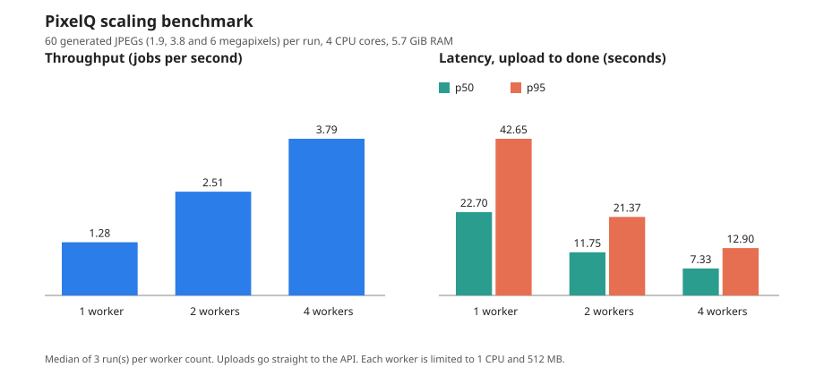

# Measurements

This page records what was measured on PixelQ, how, and what the numbers do not show. Everything here was run by hand on one PC, so read the numbers as "what happened on this machine", not as a promise.

## Environment

| | |
| --- | --- |
| Machine | A desktop PC with an Intel Core i5-4570 (4 cores, 3.2 GHz). WSL sees 5.7 GiB RAM and 2 GiB swap |
| OS | Ubuntu 24.04.4 LTS on WSL2, kernel 6.18.54.1-microsoft-standard-WSL2 |
| Docker | Docker 29.8.1, Compose 5.5.1 |
| Node | 26.13.0 for the tests dated 4 November 2026. The scaling benchmark and the image-size comparison with plain `node` were measured earlier on 24.21. |
| Images | `node:26.13-slim` (Debian 13) for the api and worker |
| Network | Slow home internet, which makes cold builds long (see "Build and CI") |

## Image sizes

Local, uncompressed sizes from `docker images`, one measurement each.

| Image | Node 24.21 (before) | Node 26.13 (now) |
| --- | --- | --- |
| pixelq-api | 383 MB | 407 MB |
| pixelq-worker | 377 MB | 400 MB |
| pixelq-gateway | 90.5 MB | 93.7 MB |
| `node` slim base image | 332 MB | 355 MB |
| postgres 18.6 (Alpine) | 433 MB | |
| redis 8.6 (Alpine) | 135 MB | |

The growth of about 23 MB is the same as the growth of the base image, so the application layers did not get bigger.

**Slim versus plain.** The worker built on plain `node:24.21` was 1.69 GB, about 4.5 times larger than 377 MB on `node:24.21-slim`. This was measured once on Node 24 and not repeated on 26. Docker Hardened Images were not compared.

```bash
docker images --format 'table {{.Repository}}\t{{.Tag}}\t{{.Size}}' | grep -E "pixelq|postgres|redis|node"
```

## Hardening check

`./scripts/verify-hardening.sh` on the base stack (`COMPOSE_FILE=docker-compose.yml`), Node 26.13, 4 November 2026:

```text
Worker container: pixelq-worker-1
1/5 Read-only root filesystem
  [PASS] write to / refused (touch: cannot touch '/pixelq-write-test': Read-only file system); /tmp is writable as intended
2/5 No capabilities, no new privileges
  [PASS] CapEff=0000000000000000 CapBnd=0000000000000000 NoNewPrivs=1
3/5 No outbound internet
  [PASS] public site unreachable (blocked: EAI_AGAIN); the api is reachable on the internal network
4/5 Memory and CPU limits
  [PASS] memory 512 MB, swap limit 512 MB (equal), CPU limit 1.00
5/5 Non-root user
  [PASS] uid=1000(node) gid=1000(node) groups=1000(node)

API container: pixelq-api-1
1/2 No outbound internet
  [PASS] public site unreachable (blocked: EAI_AGAIN); postgres is reachable on the internal network
2/2 Attached to internal networks only
  [PASS] networks: pixelq_backend pixelq_frontend (all internal)

HARDENING CHECKS PASSED
```

**The script can fail.** Every "blocked" check first runs a control, so it cannot pass because of a broken test. It was also pointed at weak containers on purpose and failed for the right reasons:

- A container on an ordinary network (`bridge`) failed both api checks: "reached the internet" and "attached to an ordinary network: bridge".
- Running it against the dev stack (which gives the api the ordinary `dev` network on purpose) failed the same two checks. This is why the script says to run it against the base stack only.

## Scaling benchmark (Node 24.21)

`node scripts/benchmark.ts`: 60 generated JPEGs per run (1.9, 3.8 and 6 megapixels), uploaded all at once straight to the api. Worker counts 1, 2 and 4, three runs each after an uncounted warm-up. The values are medians of the three runs. No job failed in the 9 runs.



| Workers | Jobs per second | Speed-up | Burst latency p50 / p95 (s) | One image, p50 / p95 (s) | Worker CPU average | Worker memory peak | Whole stack peak |
| --- | --- | --- | --- | --- | --- | --- | --- |
| 1 | 1.28 | 1.00 | 22.7 / 42.6 | 0.78 / 0.89 | 94% | 207 MiB | 407 MiB |
| 2 | 2.51 | 1.95 | 11.8 / 21.4 | 0.79 / 0.89 | 178% | 252 MiB | 771 MiB |
| 4 | 3.79 | 2.95 | 7.3 / 12.9 | 0.92 / 1.85 | 287% | 276 MiB | 1282 MiB |

(CPU: 100% is one core. Memory limit per worker: 512 MiB.) The raw numbers are in [benchmark.csv](benchmark.csv).

**Caveats**

- One older desktop PC with 4 cores. The load generator, Docker and the stack share the same CPUs.
- The images are generated noise, which is probably harder to decode than real photos.
- "Burst latency" is the time from upload to done when 60 images arrive at once, so it includes waiting in the queue. One image takes about 0.8 s to process.
- Uploads go straight to the api (the benchmark overlay publishes port 3000), so the gateway's rate limit is not part of these numbers.
- `docker stats` is sampled about every 1 to 2 seconds, so short memory peaks can be missed.
- With one worker the runs ranged from 1.27 to 1.67 jobs per second.
- At 4 workers each worker used about 72% of its CPU, and the reason was not found.
- **Not repeated on Node 26.** After the move to Node 26.13 only a small trial was run (12 generated images, one worker, one run): 1.28 jobs per second, the same as the Node 24 median. That is a sanity check, not a re-run of the benchmark.

## Large images (Node 26.13, 4 November 2026)

**Question:** what does one very large image do to a worker with a 512 MB limit?

**Method.** The worker was restarted before each test so its memory counter started fresh. After the job finished, the exact peak was read from the container's cgroup file `memory.peak` (cgroup v2, Linux 5.19 or newer), and `memory.events` was checked for `oom_kill`. Images were uploaded through the gateway. Times are `startedAt` to `finishedAt` from the job record.

| Image | File size | Result | Time | Peak memory (baseline after restart) |
| --- | --- | --- | --- | --- |
| JPEG, 7500 x 6000 (45.0 MP) | 5.0 MB | `done`, attempts 1 | 1.1 s | 89 MiB (45 MiB) |
| JPEG, 8250 x 6750 (55.7 MP, over the 50 MP cap) | 6.2 MB | `failed`: "The image is too large (too many pixels)." attempts 1, no retry | 8 ms | still 89 MiB |
| PNG, 7000 x 7000 with alpha (49.0 MP) | 0.97 MB | `done`, attempts 1 | 5.1 s | 181 MiB (44 MiB) |

`oom_kill` was 0 in all tests. The 45 MP job produced outputs 320, 1280 and 2048 px wide (the full variant is 780 KB from a 4.97 MB original).

**How to read this**

- The JPEG is cheap because sharp can shrink a JPEG while it decodes. A PNG cannot, so it takes longer (5.1 s against 1.1 s) and uses more memory. The 49 MP PNG is the worst case that was measured.
- The decoded size of that PNG is about 187 MiB (7000 x 7000 x 4 bytes), and the peak was a little lower, so the worker did not hold the whole image at once. The exact reason was not investigated.
- The over-limit image is refused from its header before decoding, which is why memory did not grow.
- Do not compare 89 MiB with the 207 MiB of the benchmark. The benchmark number comes from sampling during 60 uploads in a row. This one is the exact peak for a single image.

**Caveats**

- One run per image, on one machine.
- The JPEGs are small noise images enlarged 15 times (so they fit under 10 MB), and the PNG is one plain colour. Real photos would behave differently, mostly in time.
- **Not tested:** 16-bit PNGs and interlaced PNGs, which may need more memory than the 8-bit case.
- `memory.peak` includes file cache as well as program memory.

<details>
<summary>Commands used</summary>

Make the two JPEGs (run from the repository root):

```bash
node --input-type=module -e '
import { createRequire } from "node:module";
import { writeFile } from "node:fs/promises";
const sharp = createRequire(process.cwd() + "/worker/package.json")("sharp");
async function make(w, h, file) {
  const small = await sharp({ create: { width: w / 15, height: h / 15, channels: 3, background: { r: 128, g: 128, b: 128 }, noise: { type: "gaussian", mean: 128, sigma: 40 } } }).png().toBuffer();
  const big = await sharp(small).resize(w, h, { kernel: "cubic" }).jpeg({ quality: 80 }).toBuffer();
  await writeFile(file, big);
}
await make(7500, 6000, "/tmp/big-45mp.jpg");
await make(8250, 6750, "/tmp/big-56mp.jpg");
'
```

Make the PNG:

```bash
node --input-type=module -e '
import { createRequire } from "node:module";
const sharp = createRequire(process.cwd() + "/worker/package.json")("sharp");
await sharp({ create: { width: 7000, height: 7000, channels: 4, background: { r: 90, g: 140, b: 200, alpha: 1 } } }).png().toFile("/tmp/big-49mp.png");
'
```

Restart the worker, upload, wait, and read the peak:

```bash
docker compose restart worker && docker compose up -d --wait
W=$(docker compose ps -q worker)
echo "baseline: $(( $(docker exec $W cat /sys/fs/cgroup/memory.peak) / 1048576 )) MiB"
ID=$(curl -s -F 'file=@/tmp/big-45mp.jpg;type=image/jpeg' http://127.0.0.1:8080/api/jobs | grep -o '"id":"[^"]*"' | cut -d'"' -f4)
curl -s http://127.0.0.1:8080/api/jobs/$ID
echo "peak: $(( $(docker exec $W cat /sys/fs/cgroup/memory.peak) / 1048576 )) MiB"
docker exec $W cat /sys/fs/cgroup/memory.events | grep oom
```

</details>

## Rate limit (Node 26.13, 4 November 2026)

**Configuration.** `limit_req_zone ... rate=30r/m` and `limit_req zone=uploads burst=10 nodelay` on `/api/`, status `429`. Only `POST` requests get a key, so reads are never counted.

**Prediction.** At one request every 2 seconds with a burst of 10, a fast series of uploads should have 11 accepted and the 12th refused.

**Method.** After 25 s without uploads, 15 fast uploads of a small text file to `POST /api/jobs` through the gateway. A text file was used on purpose: the api answers `415` and stores nothing, so the test costs no disk and starts no jobs. Then 30 fast `GET /api/health` requests, a 3 s pause, and one more upload.

| Request | Answer |
| --- | --- |
| Uploads 1 to 11 | `415` (passed the gateway, refused by the api) |
| **Uploads 12 to 15** | **`429`** (refused by the gateway) |
| 30 health requests right after | all `200` |
| One upload after 3 s | `415` (the limiter let it through) |

The prediction was right. One run only, so the exact request number could differ if earlier uploads were still counted (that is why the test waits 25 s first).

```bash
echo hello > /tmp/not-an-image.txt
sleep 25
for i in $(seq 1 15); do echo "$i: $(curl -s -o /dev/null -w '%{http_code}' -F 'file=@/tmp/not-an-image.txt;type=text/plain' http://127.0.0.1:8080/api/jobs)"; done
```

## Kill demo

`./scripts/kill-demo.sh` starts two workers, uploads an image, waits until it is `processing`, kills the worker that holds it with `SIGKILL`, and waits until the job finishes by itself. It then checks that `attempts` is at least 2 and that the three variants exist. The recording is `docs/kill-demo.gif`.

| Settings | Result |
| --- | --- |
| Demo settings (lock 6 s, stalled check 3 s), Node 24.21, one recorded run | Recovered 8 s after the kill, `attempts` 2. Three runs in a row passed. |
| Demo settings, Node 26.13, 4 November 2026, one run | Recovered 19 s after the kill, `attempts` 2, passed. |
| BullMQ default settings (lock 30 s, stalled check 30 s), Node 24.21, one run | 60.3 s |

The recovery time depends on when the kill falls inside the lock and stalled-check cycle, so one number is not a promise. The difference between 8 s and 19 s with the same settings was not investigated.

## Tests, build and CI

| | |
| --- | --- |
| Unit tests | api 43, worker 65, frontend 13, benchmark helpers 17 (the benchmark helper tests run by hand with `node --test scripts/bench-stats.test.ts`) |
| Smoke test | Upload, processing, three variants downloaded as `image/webp`, and a text file refused with `415`. Passed on Node 26.13. |
| CI, pull request | 1 min 51 s (the Node 26 pull request, warm cache). 1 min for the `edge` network pull request. |
| CI, `main` with the push to ECR Public | 2 min 54 s |
| Cold build on this machine | The three images took more than 10 minutes to rebuild after the Node 26 change (not timed exactly), because every layer is rebuilt and the three `pnpm install` steps dominate on a slow connection. |
| Fresh clone (earlier check, Node 24) | First `docker compose up -d --wait` took 12 min 29 s and ended with five healthy services, with only the gateway publishing a port (`127.0.0.1:8080`). Same machine, base images already cached. |

## Checks done by hand (Node 26.13, 4 November 2026)

These support the claims in [threat-model.md](threat-model.md). Each was run once.

| Check | Result |
| --- | --- |
| Text file declared as `image/jpeg` | `415` |
| Upload named `../../../tmp/pwned.jpg` | Accepted (`202`), stored as `<uuid>.jpg`. The uploads folder holds only UUID names. |
| Download request with `..%2F..%2Fetc%2Fpasswd` as the variant | `400` |
| Unknown job id | `{"error":"Job not found."}` |
| Malformed job id | `{"error":"Invalid request: params/id must match format \"uuid\""}` |
| Download headers | `Content-Type: image/webp`, `content-disposition: attachment; filename="exif-test-full.webp"`, `X-Content-Type-Options: nosniff` (twice: one from the api, one from Nginx) |
| EXIF marker text in the input, searched in the three outputs | Found in the input, found in none of the outputs (0, 0, 0) |
| Client address in the Nginx access log for a request from the same machine | `172.21.0.1` (the Docker network gateway), not `127.0.0.1` |

The EXIF test used the Copyright and Artist fields. GPS fields were not tested separately.

## What was not measured

- A re-run of the full benchmark on Node 26.
- 16-bit and interlaced PNG memory.
- Behavior on a different computer, or on a cold cache.
- The effect of real photographs instead of generated images.
- Throughput through the gateway (the benchmark bypasses it).
